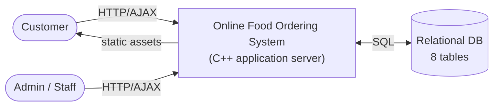
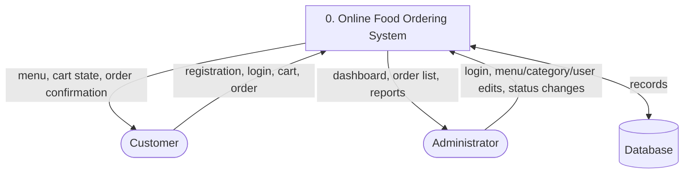
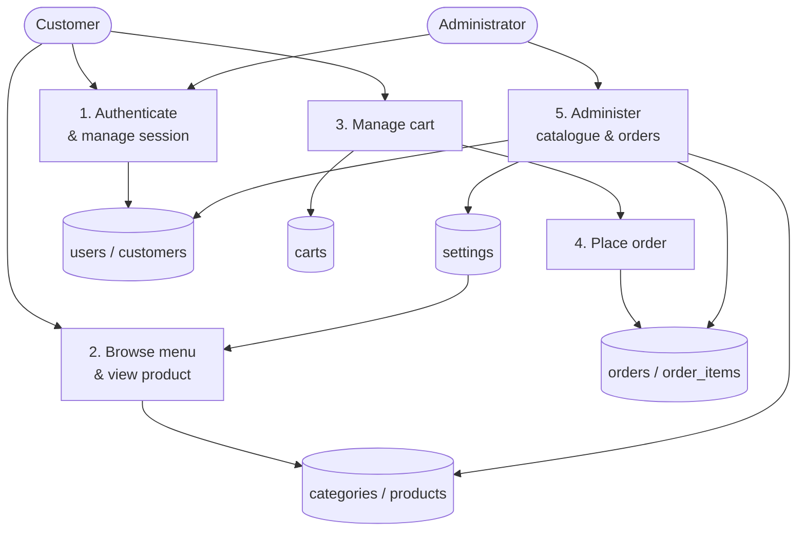
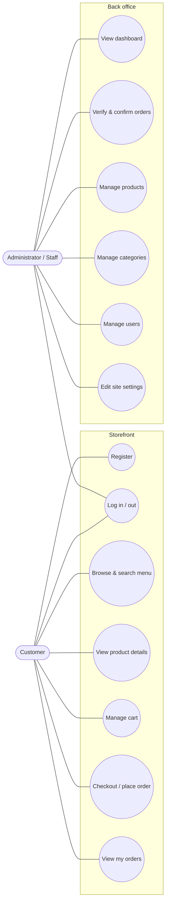
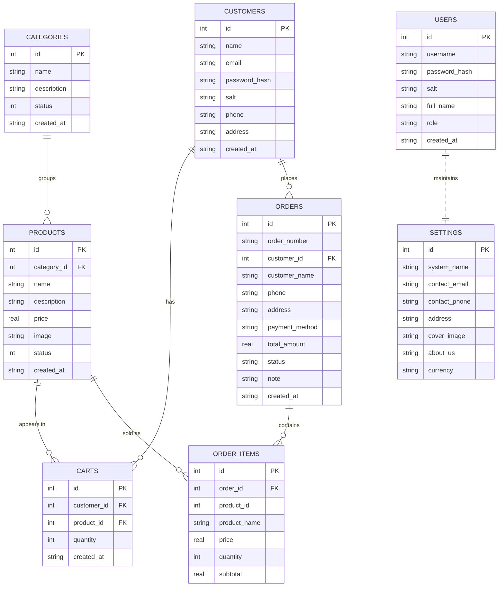
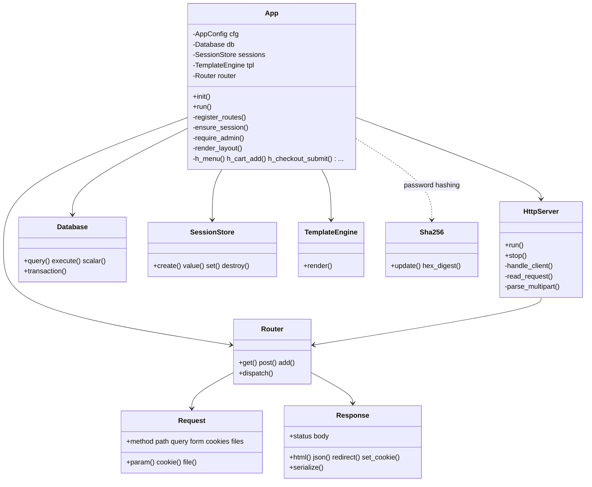
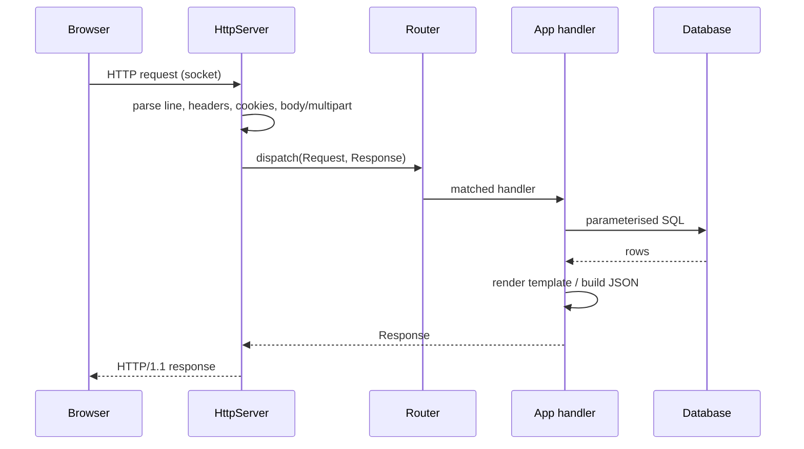

# Online Food Ordering System — Design Document

This document records the analysis and design of the Online Food Ordering
System: context and data-flow diagrams, use cases, the entity-relationship
model, the class design, the database schema, the 28 test cases, and the
security analysis. Diagrams are written in Mermaid (renders on GitHub and in
most Markdown viewers).

---

## 1. System context

Two actors use the system through a web browser:

- **Customer** — browses the menu, registers/logs in, manages a cart and places
  orders.
- **Administrator / Staff** — logs into a protected back-office to verify and
  confirm orders and to manage the catalogue, users and settings.

The C++ application server handles all requests and persists everything to a
single relational database (SQLite; MySQL-compatible schema).

---

## 2. Data-flow diagram (Level 0 / context)

### 2.1 Data-flow diagram (Level 1)

---

## 3. Use-case diagram

---

## 4. Entity-relationship diagram

The **8 tables** are: `users`, `customers`, `categories`, `products`, `carts`,
`orders`, `order_items`, `settings`. Full DDL is in
[`data/schema.sql`](../data/schema.sql).

---

## 5. Class / module design

The server is organised into single-responsibility modules (one header + source
each). The `App` facade owns the long-lived services and all request handlers.

### Request lifecycle

---

## 6. Test cases (28)

Executed automatically by [`tests/run_tests.sh`](../tests/run_tests.sh)
(`make test`). Each drives the running server over HTTP.

| #  | Area           | Test case                                   | Expected result |
|----|----------------|---------------------------------------------|-----------------|
| 1  | Browsing       | Home page loads                             | HTTP 200 |
| 2  | Browsing       | Home shows configured system name           | name present |
| 3  | Browsing       | Menu page loads                             | HTTP 200 |
| 4  | Browsing       | Menu pagination page size                   | 6 cards/page |
| 5  | Browsing       | Keyword search filters catalogue            | matching item shown |
| 6  | Browsing       | Category filter restricts items             | only that category |
| 7  | Browsing       | Product details AJAX                         | JSON `success:true` |
| 8  | Browsing       | Product AJAX with unknown id                | HTTP 404 |
| 9  | Browsing       | CSS asset served                            | `text/css` |
| 10 | Registration   | Register valid account                      | redirect to `/menu` |
| 11 | Registration   | Duplicate email rejected                    | error message |
| 12 | Registration   | Password mismatch rejected                  | error message |
| 13 | Registration   | Too-short password rejected                 | error message |
| 14 | Authentication | Login with wrong password rejected          | error message |
| 15 | Authentication | Login with correct password                 | redirect to `/menu` |
| 16 | Cart           | Add to cart without login                   | HTTP 401 + `login_required` |
| 17 | Cart           | Authenticated add to cart                   | `cart_count:2` |
| 18 | Cart           | Adding same item merges quantity            | `cart_count:3` |
| 19 | Cart           | Update quantity recomputes subtotal         | `line_subtotal:"360.00"` |
| 20 | Cart           | Remove line updates cart                    | remaining `items:1` |
| 21 | Checkout       | Checkout with missing fields                | HTTP 400 |
| 22 | Checkout       | Checkout places order                       | `order_number:"ORD…"` |
| 23 | Checkout       | Cart emptied after checkout                 | `count:0` |
| 24 | Orders         | My Orders shows a Pending order             | "Pending" |
| 25 | Administration | Admin route requires auth                   | redirect to `/admin/login` |
| 26 | Administration | Admin login succeeds                        | redirect to `/admin` |
| 27 | Administration | Confirm order via AJAX                      | `status:"Confirmed"` |
| 28 | Administration | Create category (CRUD)                      | HTTP 302 (saved) |

---

## 7. Security analysis & future enhancements

**Implemented**
- Passwords: 16-byte random salt + **12 000-round SHA-256**; constant-time
  verify. No plaintext storage.
- **Session access control** on every `/admin/*` route; 256-bit random tokens
  in `HttpOnly`, `SameSite=Lax` cookies; idle TTL with lazy GC.
- **Parameterised SQL** throughout — no string-concatenated queries.
- **Output escaping** by default in the template engine (XSS mitigation);
  JSON control-character escaping.
- Static serving restricted to `/public/` with `..` traversal rejection.
- Image-only upload validation; randomised stored filenames; 8 MB body cap.

**Future enhancements** (as noted in the abstract)
- Online **payment gateway** integration (currently pay-on-delivery).
- **Order notifications** (email / SMS / push) on status changes.
- **Sales reports** and analytics on the dashboard.
- **CSRF tokens** on state-changing POST forms.
- Upgrade password hashing to **bcrypt / Argon2id**.
- HTTPS/TLS termination (via reverse proxy or built-in).
- Role-based granularity for staff vs. administrators.

---

## 8. Mapping the schema to MySQL/MariaDB

The SQL is standard; to target MySQL instead of SQLite, change only:

- `INTEGER PRIMARY KEY AUTOINCREMENT` → `INT AUTO_INCREMENT PRIMARY KEY`
- `REAL` → `DECIMAL(10,2)`
- `TEXT` for short fields → `VARCHAR(n)` (optional)
- Append `ENGINE=InnoDB DEFAULT CHARSET=utf8mb4;` to each `CREATE TABLE`
- Replace the SQLite `ON CONFLICT(...) DO UPDATE` upsert in the cart with MySQL's
  `INSERT ... ON DUPLICATE KEY UPDATE`

The application's `Database` class would swap its SQLite backend for the MySQL C
client (`libmysqlclient`) behind the same `query`/`execute`/`transaction`
interface.
